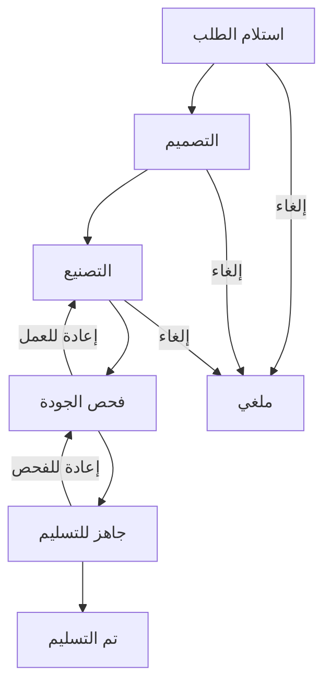

<div align="center">

# 🦷 Dental Laboratory Management System

### نظام إدارة مخابر الأسنان

**Repository: `dental-laboratory-management-system`**  
**A Laravel 12 graduation project | مشروع تخرج باستخدام Laravel 12**


**[العربية](#arabic) · [English](#english)**

</div>

---

<a id="arabic"></a>

## 🇸🇾 نبذة عن المشروع

**نظام إدارة مخابر الأسنان** تطبيق ويب لإدارة دورة العمل داخل مخبر الأسنان، من تسجيل بيانات الطبيب والمريض واستلام الطلب المخبري، مرورًا بمراحل التصميم والتصنيع وفحص الجودة، حتى التسليم وإدارة الفاتورة والمدفوعات.

صُمم المشروع بواجهة **عربية من اليمين إلى اليسار (RTL)**، ويعتمد على **Laravel 12 وMySQL**، مع واجهات برمجة تطبيقات **REST API** محمية باستخدام **Laravel Sanctum**.

> **السياق الأكاديمي:** مشروع برمجي تعليمي قابل للتطوير ضمن مشاريع التخرج في جامعة حلب. لا يُعد منتجًا طبيًا أو نظامًا محاسبيًا معتمدًا للاستخدام الإنتاجي دون مراجعات واختبارات إضافية.

### 🎯 أهداف المشروع

- تحويل متابعة الحالات المخبرية من الإجراءات الورقية إلى نظام إلكتروني منظم.
- تسهيل إدارة الأطباء والمرضى وأنواع الأعمال والطلبات.
- تتبع مرحلة كل طلب ومواعيد التسليم وتكليف الفنيين.
- تنظيم الفواتير والدفعات الجزئية والمتبقي من المبالغ.
- توفير لوحة مؤشرات وتقارير تساعد إدارة المخبر على اتخاذ القرارات.
- تطبيق صلاحيات مختلفة للمستخدمين بحسب طبيعة عملهم.

### ✨ الوظائف المتوفرة

| الوحدة | أهم الوظائف |
|---|---|
| إدارة المستخدمين | تسجيل الدخول والخروج، إدارة حسابات الموظفين، تفعيل الحسابات وتعطيلها، خمسة أدوار |
| إدارة الأطباء | إضافة وتعديل وبحث وحفظ بيانات الأطباء والعيادات |
| إدارة المرضى | ملفات المرضى وربطهم بالأطباء |
| أنواع الأعمال | كتالوج للتعويضات السنية وأسعارها والمدد التقديرية |
| الطلبات المخبرية | تسجيل الطلبات واللون والمادة وأرقام الأسنان والأولوية ومواعيد العمل |
| مراحل التنفيذ | الانتقال بين حالات العمل وتوثيق تاريخ التغييرات |
| الفواتير | إنشاء فاتورة مرتبطة بكل طلب مع دعم الخصم والضريبة |
| المدفوعات | تسجيل الدفعات وطرق الدفع ومنع تجاوز إجمالي الفاتورة |
| لوحة التحكم | مؤشرات تشغيلية وملخصات للحالات ومواعيد التسليم |
| التقارير | ترشيح البيانات حسب التاريخ وتصدير تقارير CSV |
| REST API | تسجيل دخول برمز وصول، واستعراض الطلبات وبعض الأدلة وتحديث الحالة بحسب الصلاحية |

### 🔄 دورة معالجة الطلب



> تُنشأ فاتورة الطلب عند إنشاء الطلب، ويمكن تسجيل دفعات جزئية أو كاملة وفق صلاحيات المستخدم. الانتقالات بين الحالات مقيدة بقواعد النظام.

### 👥 أدوار المستخدمين

| الدور التقني | الوصف |
|---|---|
| `admin` | مدير النظام، وله صلاحيات الإدارة الشاملة وإدارة حسابات الموظفين |
| `manager` | مدير المخبر، ويتابع التشغيل والطلبات والحسابات والتقارير |
| `technician` | فني المخبر، ويتابع الطلبات المسندة إليه ويحدث مراحلها المسموح بها |
| `accountant` | المحاسب، ويتعامل مع الفواتير والمدفوعات والتقارير المالية |
| `receptionist` | موظف الاستقبال، ويدير بيانات الأطباء والمرضى وتسجيل الطلبات |

### 🛠️ التقنيات المستخدمة

- **Backend:** PHP 8.2+ / Laravel 12 / Eloquent ORM.
- **Database:** MySQL (أو MariaDB متوافقة).
- **Frontend:** Blade, HTML5, CSS3, JavaScript، دون الحاجة إلى Node.js لتشغيل الواجهة الحالية.
- **Authentication & Authorization:** جلسات Laravel، وسيط صلاحيات الأدوار، وLaravel Sanctum لواجهات API.
- **Architecture:** MVC، ومخططات قاعدة بيانات باستخدام Migrations.
- **Testing:** اختبارات Feature مضمنة، تتطلب حزم التطوير وامتداد `pdo_sqlite`.

### 🚀 المتطلبات والتثبيت محليًا

**المتطلبات:** PHP 8.2 أو أحدث، Composer 2، MySQL، وإضافات PHP المعتادة لـ Laravel ومنها `pdo_mysql` و`mbstring` و`openssl`.

1. افتح مجلد المشروع في **VS Code** أو PowerShell.
2. ثبّت مكتبات PHP:

```powershell
composer install --prefer-dist
```

> إذا كان الاتصال بطيئًا وتحتاج إلى تشغيل المشروع فقط دون أدوات التطوير، استخدم: `composer install --no-dev --prefer-dist --no-progress`.

3. أنشئ ملف البيئة لأول مرة (PowerShell):

```powershell
if (-not (Test-Path .env)) { Copy-Item .env.example .env }
php artisan key:generate
```

4. أنشئ قاعدة بيانات باسم `dental_lab`، أو اسم آخر من اختيارك، وعدّل ملف `.env`:

```dotenv
APP_NAME="Dental Lab Management"
APP_ENV=local
APP_DEBUG=true
APP_URL=http://127.0.0.1:8000
APP_LOCALE=ar

DB_CONNECTION=mysql
DB_HOST=127.0.0.1
DB_PORT=3306
DB_DATABASE=dental_lab
DB_USERNAME=root
DB_PASSWORD=

ADMIN_NAME="Lab Administrator"
ADMIN_EMAIL=admin@example.test
ADMIN_PASSWORD="REPLACE_WITH_A_UNIQUE_STRONG_PASSWORD"
DEMO_DATA=false
```

> القيم السابقة **أمثلة فقط**. يجب استبدال البريد وكلمة المرور ببياناتك الشخصية. يشترط النظام أن تكون كلمة مرور المدير **12 محرفًا على الأقل**. لا تضع كلمات مرور حقيقية في ملفات GitHub.

5. أنشئ الجداول والبيانات الأساسية، ثم شغّل الخادم:

```powershell
php artisan migrate --seed
php artisan serve
```

6. افتح **http://127.0.0.1:8000** وسجّل الدخول ببريد المدير وكلمة المرور المحددين في `.env`.

**في حال تنفيذ Migrations سابقًا:** يكفي استخدام `php artisan db:seed` لإضافة بيانات المدير والكتالوج دون إعادة إنشاء الجداول.

**بيانات العرض الاختيارية:** يمكن تفعيل `DEMO_DATA=true` ثم تشغيل `php artisan db:seed` لإضافة بيانات تجريبية. لا تفعل ذلك على قاعدة بيانات تحتوي على بيانات مرضى حقيقية.

### 🗂️ بنية المشروع

```text
app/
├── Http/
│   ├── Controllers/        # متحكمات الويب و API
│   └── Middleware/         # صلاحيات الأدوار والتحقق من نشاط الحساب
└── Models/                 # نماذج Eloquent
bootstrap/                  # تهيئة Laravel 12
config/                     # إعدادات التطبيق
database/
├── migrations/             # بنية الجداول والعلاقات
└── seeders/                # حساب المدير والبيانات التجريبية
resources/views/            # واجهات Blade العربية
public/
├── css/app.css             # التنسيق والتجاوب
└── js/app.js               # تفاعلات الواجهة
routes/
├── web.php                 # مسارات الويب
└── api.php                 # REST API
docs/                       # وثائق المعمارية وأمثلة API
tests/Feature/              # اختبارات سير العمل
```

### 🗃️ قاعدة البيانات

أهم جداول الأعمال: `users`, `doctors`, `patients`, `work_types`, `lab_orders`, `order_stage_histories`, `invoices`, `payments`.

كما تتضمن قاعدة البيانات جدولي `personal_access_tokens` و`password_reset_tokens` لدعم المصادقة. ترتبط الطلبات بالأطباء والمرضى وأنواع الأعمال، ويرتبط كل طلب بفاتورة واحدة، وتُحفظ المدفوعات على مستوى الفاتورة وتغييرات الحالة في سجل مستقل.

### 🔌 REST API

المسار الأساسي: `/api/v1`.

| Method | Endpoint | الوظيفة |
|---|---|---|
| `POST` | `/api/v1/login` | تسجيل الدخول وإصدار رمز Sanctum |
| `GET` | `/api/v1/me` | بيانات المستخدم الحالي |
| `POST` | `/api/v1/logout` | إبطال الرمز الحالي |
| `GET` | `/api/v1/orders` | عرض الطلبات |
| `GET` | `/api/v1/orders/{id}` | تفاصيل الطلب |
| `POST` | `/api/v1/orders` | إنشاء طلب، حسب الصلاحية |
| `PATCH` | `/api/v1/orders/{id}/status` | تغيير مرحلة الطلب، حسب الصلاحية |
| `GET` | `/api/v1/doctors` | قائمة الأطباء |
| `GET` | `/api/v1/patients` | قائمة المرضى |
| `GET` | `/api/v1/work-types` | أنواع الأعمال |

تتطلب المسارات المحمية إرسال الترويسة `Authorization: Bearer YOUR_TOKEN`. للمزيد: [`docs/API_EXAMPLES.md`](docs/API_EXAMPLES.md).

### 🧪 الاختبارات

لتشغيل الاختبارات، ثبّت حزم التطوير (`composer install` دون `--no-dev`) وتأكد من تفعيل امتداد PHP `pdo_sqlite`، ثم نفّذ:

```powershell
php artisan test
```

الاختبارات البرمجية موجودة في `tests/Feature`، ولا تعني الإشارة إليها أن جميع سيناريوهات الإنتاج خضعت للاختبار.

### 🔐 إرشادات الأمان والنشر

- **لا ترفع ملف `.env` مطلقًا إلى GitHub**، ولا تنشر كلمات المرور أو مفتاح `APP_KEY` أو بيانات مرضى حقيقية.
- تأكد من أن `.gitignore` يستبعد `.env` و`vendor/` وملفات السجلات.
- في الإنتاج استخدم `APP_DEBUG=false` وHTTPS، واضبط جذر الموقع على مجلد `public/`.
- فعّل النسخ الاحتياطي المنتظم، وحدّد سياسة للاحتفاظ ببيانات المرضى والوصول إليها.
- استخدام المشروع في منشأة فعلية يتطلب مراجعة متطلبات الخصوصية والأمان والامتثال المحلي.

### 📌 تطويرات مستقبلية مقترحة (غير منفذة في الإصدار الحالي)

- إشعارات تلقائية بالبريد أو الرسائل لمواعيد التسليم.
- رفع الصور والملفات الطبية وربطها بالحالات مع ضوابط وصول مناسبة.
- تكامل مع تطبيق هاتف محمول باستخدام REST API.
- تحسينات متقدمة على الجرد والمحاسبة وسجلات التدقيق.

---

<a id="english"></a>

## 🇬🇧 Project Overview

**Dental Laboratory Management System** is a Laravel 12 web application designed to organize dental laboratory operations. It manages dentists, patients, work catalogs, orders, production stages, delivery dates, invoices, payments, and reporting through a responsive **Arabic right-to-left dashboard**.

Developed as an **academic graduation-project prototype associated with the University of Aleppo context**, it offers structured role-based access and a Laravel Sanctum-protected REST API.

### Key Features

- **User management:** Session-based login, staff accounts, five roles, and account activation controls.
- **Dentists and patients:** Organized directory and associated patient records.
- **Work types:** Dental restoration catalog with estimated prices and durations.
- **Lab orders:** Order number, dentist/patient, shade, material, teeth, priority, due date, and technician assignment.
- **Production tracking:** Validated workflow transitions with timestamped stage history.
- **Financial management:** Automatically generated invoices, discounts, taxes, and partial/full payments.
- **Dashboard and reports:** Summary metrics, due/late orders, date filters, and CSV export.
- **REST API:** Token-based authentication and authorized order/directory endpoints.

### Tech Stack

| Layer | Technology |
|---|---|
| Backend | PHP 8.2+, Laravel 12 |
| Database | MySQL, Eloquent ORM |
| Web interface | Blade, HTML, CSS, JavaScript (Arabic RTL) |
| API authentication | Laravel Sanctum |
| Architecture | MVC, migrations, middleware-based role authorization |
| Tests | Laravel feature tests, SQLite in-memory for testing |

**Node.js is not required** to run the current frontend assets.

### Installation

Requirements: PHP 8.2+, Composer 2, MySQL, and the required PHP extensions (including `pdo_mysql`).

```powershell
composer install --prefer-dist
if (-not (Test-Path .env)) { Copy-Item .env.example .env }
php artisan key:generate
```

Configure the database and an initial administrator in `.env` (the password must be at least **12 characters**):

```dotenv
DB_CONNECTION=mysql
DB_HOST=127.0.0.1
DB_PORT=3306
DB_DATABASE=dental_lab
DB_USERNAME=root
DB_PASSWORD=
ADMIN_NAME="Lab Administrator"
ADMIN_EMAIL=admin@example.test
ADMIN_PASSWORD="REPLACE_WITH_A_UNIQUE_STRONG_PASSWORD"
DEMO_DATA=false
```

Create the MySQL database, then run:

```powershell
php artisan migrate --seed
php artisan serve
```

Visit **http://127.0.0.1:8000** and log in with your configured administrator credentials. On systems where migrations have already run, use `php artisan db:seed` instead. For slow connections, production-only dependencies can be installed with `composer install --no-dev --prefer-dist --no-progress`.

On macOS/Linux, replace the PowerShell copy command with `cp .env.example .env`.

### API and Testing

Protected API routes use `/api/v1` and `Authorization: Bearer YOUR_TOKEN`. See [`docs/API_EXAMPLES.md`](docs/API_EXAMPLES.md) for requests, and [`docs/ARCHITECTURE_AR.md`](docs/ARCHITECTURE_AR.md) for the Arabic architecture notes.

For tests, install development dependencies, enable the `pdo_sqlite` PHP extension, and run:

```bash
php artisan test
```

### Security and Scope

This repository is intended for learning, demonstration, and further development—not as a certified clinical or accounting product. Never commit `.env`, application secrets, real patient records, or credentials. Production use requires further testing, secure deployment, backups, privacy safeguards, and compliance review.

### License

This project includes an [MIT License](LICENSE). See the license file for terms and attribution.

---

<div align="center">

**Built with Laravel 12 and MySQL | مطوّر باستخدام Laravel 12 وMySQL**

*University of Aleppo graduation-project context · سياق مشروع تخرج — جامعة حلب*

</div>
